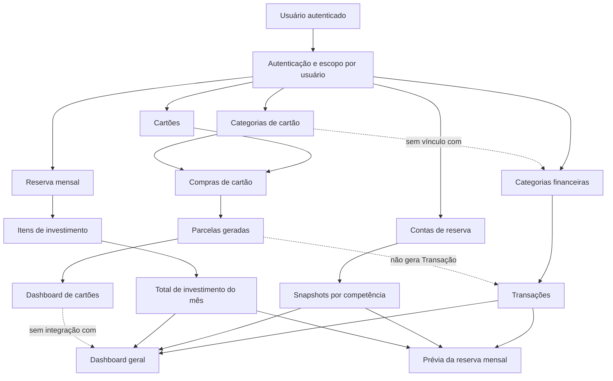

# Auditoria de regras de negócio e integração entre módulos

## Escopo e método

Esta auditoria revisa a documentação, rotas, serviços, repositórios, modelos, migrations, telas e testes existentes. O código atual foi tratado como fonte da verdade e comparado com os contextos técnicos em `.ai/`. A análise é estática: não foram feitas alterações no código ou banco de dados, e não foram executados testes.

## Resumo executivo

O sistema limita as operações financeiras aos dados do usuário autenticado e mantém separados os módulos de transações e cartões. As parcelas de cartão são geradas pelo backend, e as alterações nos itens de investimento mensal mantêm o total desses itens sincronizado dentro de uma transação.

Os principais riscos são de coerência financeira e interpretação dos indicadores:

1. **Alto — Compras de cartão não entram no dashboard geral.** Também não há migração ou vínculo entre lançamentos antigos de cartão em Transações e compras novas no módulo Cartões. Comparações antes e depois da adoção do módulo podem não ser comparáveis.
2. **Alto — O cálculo da reserva pode contar duas vezes o saldo mensal.** O usuário declara um “saldo do mês”, e o sistema soma esse saldo ao resultado das transações da competência.
3. **Alto — Aportes mensais são apresentados como parte de um total guardado patrimonial.** O sistema armazena valores de investimento por mês, mas não acompanha o saldo acumulado nem a valorização dos investimentos.
4. **Alto — Transações pendentes entram em valores apresentados como confirmados.** O status `paid` ou `pending` não altera os totais do dashboard.
5. **Médio — Arquivar uma conta de reserva altera os totais históricos.** A interface promete efeito futuro; os cálculos consultam o estado atual da conta para todas as competências.
6. **Médio — Alterar o tipo de uma categoria pode deixar transações incompatíveis e difíceis de editar.**
7. **Médio — A tendência de “Total guardado” usa a variação da reserva e ignora a variação dos investimentos.**
8. **Médio — A API aceita competências inválidas em gravações individuais de saldos de reserva.**

Os contextos do projeto já registram várias dessas limitações, em especial a separação dos cartões, a semântica dos snapshots e o arquivamento retroativo. A auditoria confirmou que elas também estão presentes no código atual.

## Mapa dos módulos e dependências

| Módulo | Recebe e armazena | Alimenta |
|---|---|---|
| Autenticação | Cadastro, credenciais e tokens Sanctum | Identidade usada para limitar operações aos dados do usuário |
| Categorias financeiras | Nome e tipo `income` ou `expense` | Classificação de Transações; nomes aparecem nos indicadores do dashboard geral |
| Transações | Categoria, valor, tipo, status, competência e marcador de recorrência | Totais, comparações, categorias e fluxo do dashboard geral; prévia da reserva mensal |
| Contas de reserva | Contas e snapshots de saldo por competência | Saldo de reserva calculado e indicadores gerais |
| Reserva mensal e itens de investimento | Observações mensais e aportes descritos por valor | `investment` e `total_saved` no dashboard geral e na tela de reserva |
| Cartões e categorias de cartão | Cartões, responsáveis e classificações próprias | Formulário de compras e agrupamentos do dashboard de cartões |
| Compras e parcelas | Compra, valor total, competências e tipo de pagamento; o backend gera parcelas | Totais por competência, cartão, responsável, categoria e projeções futuras do dashboard de cartões |
| Dashboard geral | Consulta Transações, snapshots ativos e reserva mensal | Indicadores financeiros gerais; não grava dados |
| Dashboard de cartões | Consulta parcelas geradas | Análises exclusivas de cartões; não alimenta o dashboard geral |

As rotas confirmam que os dashboards são endpoints separados ([routes/api.php](../routes/api.php#L38)). O dashboard geral calcula seus totais a partir de Transações, snapshots e reserva mensal ([DashboardService.php](../app/Services/DashboardService.php#L136)); o de cartões usa as parcelas ([CardDashboardService.php](../app/Services/CardDashboardService.php#L25)).

### Fluxo de informação

### Operações que alteram indicadores

- Criar, editar ou excluir uma Transação altera os totais gerais.
- Alterar ou remover um snapshot muda o saldo vigente nos meses seguintes até o próximo snapshot declarado.
- Criar ou alterar itens de investimento recalcula o total mensal; a atualização de compra de cartão apaga e gera novamente suas parcelas dentro de uma transação.
- Arquivar uma conta muda sua inclusão nos cálculos de todas as competências consultadas.
- Categorias gerais não invalidam o cache do dashboard; nomes podem ficar defasados por até cinco minutos.
- Cartões têm evento e versão de cache próprios. Alterações nesse módulo não atualizam o dashboard geral.

## Origem dos indicadores

### Dashboard geral

As regras centrais estão em [DashboardService.php](../app/Services/DashboardService.php#L152), [FinancialAnalyticsService.php](../app/Services/FinancialAnalyticsService.php#L99) e [MonthlyComparisonService.php](../app/Services/MonthlyComparisonService.php#L14).

| Indicador | Cálculo atual |
|---|---|
| Entradas | Soma de Transações `income` da competência |
| Gastos | Soma de Transações `expense` da competência |
| Saldo restante | Entradas − gastos |
| Reserva anterior | Soma do snapshot vigente de cada conta atualmente ativa |
| Reserva atual | Reserva anterior + saldo restante |
| Investimento | Campo `MonthlyReserve.investimento` daquela competência; zero sem registro |
| Total guardado | Reserva atual + investimento da competência |
| Médias mensais | Soma do indicador na janela dividida pelo número de competências, incluindo competências sem lançamentos |
| Melhor/pior mês | Competência com maior/menor saldo restante |
| Renda comprometida | Gastos ÷ entradas × 100; retorna zero se entradas forem zero ou negativas |
| Taxa de economia | Saldo restante ÷ entradas × 100; retorna zero se entradas forem zero ou negativas |
| Previsão de fechamento | Igual ao saldo restante da competência selecionada |
| Diferença de reserva | Reserva atual do mês selecionado − reserva atual do mês anterior; não considera investimento |
| Categorias | Gastos agrupados por categoria e comparados com a competência anterior |
| Fluxo de caixa | Entradas, gastos e saldo calculados a partir das mesmas transações, sem filtro por status |

O painel também gera evolução mensal, ranking, concentração percentual por categoria, heatmap e insights a partir desses valores. “Previsão de fechamento” é um nome mais amplo que a fórmula implementada: o valor exibido é somente o saldo restante, sem previsão de tendência ou saldo acumulado ([FinancialAnalyticsService.php](../app/Services/FinancialAnalyticsService.php#L119), [DashboardPage.vue](../frontend/src/pages/dashboard/DashboardPage.vue#L168)).

### Dashboard de cartões

O módulo agrega `card_installments`, não o valor total dos cabeçalhos das compras ([CardInstallmentRepository.php](../app/Repositories/CardInstallmentRepository.php#L57), [CardDashboardService.php](../app/Services/CardDashboardService.php#L25)).

- **Total do mês e por cartão, responsável, categoria e tipo de pagamento:** soma das parcelas com a competência selecionada.
- **Total do ano:** soma das parcelas cuja competência pertence ao ano selecionado.
- **Comprometido futuro:** soma das parcelas com competência posterior à selecionada.
- **Saldo devedor de parcelamentos:** soma das parcelas futuras cujo tipo é `installment`.
- **Evolução:** totais por competência na janela escolhida.
- **Média histórica:** média dos meses anteriores na janela, contando meses sem compras como zero.
- **Gasto atípico:** indica anomalia quando o total mensal supera em pelo menos 30% a média histórica.
- **Categoria dominante e concentração:** proporção dos gastos por categoria e soma das três maiores.

O agrupamento por pessoa usa o nome atual do responsável no cartão, não um valor registrado na compra. Editar esse responsável pode, portanto, reclassificar compras históricas.

## Problemas comprovados

### 1. Compras de cartão fora do dashboard geral — **Alto**

**Regra atual:** o dashboard geral agrega Transações; compras de cartão alimentam somente parcelas e o dashboard de cartões. O contexto de cartões também registra que transações antigas de cartão permanecem e que novos lançamentos detalhados devem ser feitos no módulo Cartões ([DashboardService.php](../app/Services/DashboardService.php#L139), [CardDashboardService.php](../app/Services/CardDashboardService.php#L43), [contexto de cartões](../.ai/backend/contexts/cards.md)).

**Impacto e exemplo:** uma compra de R$ 1.200 em cartão pode aparecer no dashboard de cartões, mas não nos gastos nem na taxa de comprometimento do dashboard geral. Se meses antigos registravam compras de cartão como Transações e meses novos usam Cartões, a série histórica muda de cobertura. Não há integração que detecte uma compra lançada nos dois módulos.

**Recomendação:** decidir se o produto precisa de uma visão consolidada. Se sim, definir um registro financeiro unificado ou uma camada consolidada, com vínculo entre compra, parcelas e eventual pagamento de fatura para evitar contabilizar a compra e sua liquidação como duas despesas. Também definir como comparar ou reconciliar registros antigos.

### 2. Saldo declarado somado ao resultado do mês pode duplicar dinheiro — **Alto; semântica precisa de decisão**

**Regra atual:** o sistema herda o snapshot vigente até a competência e o chama de reserva anterior; depois soma o saldo restante do mês. A tela solicita “Saldo do mês” e exibe “Reserva atual (contas + saldo do mês)” ([ReserveAccountEntryRepository.php](../app/Repositories/ReserveAccountEntryRepository.php#L77), [DashboardService.php](../app/Services/DashboardService.php#L158), [ReserveAccountRow.vue](../frontend/src/components/reserve/ReserveAccountRow.vue#L61), [MonthlyReserveEditor.vue](../frontend/src/components/reserve/MonthlyReserveEditor.vue#L390)).

**Impacto e exemplo:** se o saldo declarado de R$ 10.500 for o saldo de encerramento do mês e já incluir uma sobra de R$ 500, a fórmula apresenta R$ 11.000. Se esse campo representar o saldo de abertura, somar a sobra pode fazer sentido. O código e a interface não estabelecem claramente o momento do saldo.

**Recomendação:** definir snapshots explicitamente como saldo de abertura ou encerramento. Para saldo de encerramento, não somar novamente o fluxo do mês; para saldo de abertura, deixar claro que é uma base inicial e definir como a próxima competência herda o saldo.

### 3. Aportes mensais tratados como total patrimonial — **Alto; semântica precisa de decisão**

**Regra atual:** os itens de investimento armazenam descrição e valor mensal; o total é a soma dos itens daquela competência. `total_saved` soma esse aporte mensal à reserva calculada ([MonthlyReserveService.php](../app/Services/MonthlyReserveService.php#L172), [migration dos itens](../database/migrations/2026_07_07_000001_create_monthly_reserve_entries_table.php#L14), [DashboardService.php](../app/Services/DashboardService.php#L160)).

**Impacto e exemplo:** se o usuário aporta R$ 100 por mês durante um ano, o campo mensal representa R$ 100, não o saldo acumulado de R$ 1.200 nem o valor atual do investimento. `total_saved` não carrega os aportes dos meses anteriores, salvo se o usuário os incluir nos snapshots das contas — o que pode contar novamente o aporte do mês atual. Não existe módulo de investimento que registre posição, valorização ou resgates.

**Recomendação:** diferenciar aporte mensal (fluxo) de saldo investido (posição patrimonial). Definir se “Total guardado” é um indicador de aportes do mês ou um total de ativos; não apresentar aportes como saldo patrimonial sem registrar a posição acumulada.

### 4. Transações pendentes entram como recebimentos confirmados — **Alto**

**Regra atual:** os agregados por tipo não filtram `status`; `paid` e `pending` entram igualmente nos totais ([TransactionRepository.php](../app/Repositories/TransactionRepository.php#L51)). A interface, porém, descreve entradas como “Renda e recebimentos confirmados” ([DashboardPage.vue](../frontend/src/pages/dashboard/DashboardPage.vue#L85)).

**Impacto e exemplo:** uma receita pendente de R$ 5.000 pode ser apresentada como entrada confirmada e aumentar o saldo restante, embora o recebimento não tenha ocorrido. O status existe e pode ser filtrado na tela de Transações, mas não muda os indicadores gerais.

**Recomendação:** decidir se o dashboard representa competência prevista, realizado ou ambos. Separar confirmados e pendentes, ou ajustar rótulos e indicadores para explicitar que os totais incluem ambos. Para fluxo de caixa realizado, é necessário definir quando uma transação se considera liquidada.

### 5. Arquivamento altera o histórico — **Médio**

**Regra atual:** o repositório filtra `active=true` ao calcular reservas, sem considerar quando a conta foi arquivada ([ReserveAccountEntryRepository.php](../app/Repositories/ReserveAccountEntryRepository.php#L77)). A confirmação da interface diz que o saldo deixa de entrar “nos próximos meses” ([MonthlyReserveEditor.vue](../frontend/src/components/reserve/MonthlyReserveEditor.vue#L170)).

**Impacto e exemplo:** arquivar hoje uma conta com saldo declarado em janeiro também remove esse saldo de consultas históricas de janeiro. O teste existente confirma que a conta sai do agregado depois de arquivada ([ReserveAccountTest.php](../tests/Feature/ReserveAccountTest.php#L90)).

**Recomendação:** se arquivamento deve produzir efeito somente dali em diante, registrar uma competência efetiva de encerramento ou manter histórico da condição ativa. Caso a intenção seja recalcular todo o histórico, ajustar a mensagem da interface.

### 6. Alterar o tipo da categoria pode deixar transações incompatíveis — **Médio**

**Regra atual:** o request permite alterar `Category.type` sem consultar as transações ligadas ([UpdateCategoryRequest.php](../app/Http/Requests/Category/UpdateCategoryRequest.php#L48), [CategoryService.php](../app/Services/CategoryService.php#L35)). A compatibilidade é conferida somente ao criar ou editar uma Transação ([TransactionService.php](../app/Services/TransactionService.php#L54)).

**Impacto e exemplo:** mudar uma categoria de receita para despesa não altera uma receita já ligada a ela. A transação permanece com tipo `income`, mas sua categoria passa a ser `expense`; edições posteriores que mantenham essa associação são rejeitadas.

**Recomendação:** bloquear mudança de tipo enquanto houver transações vinculadas, ou exigir uma reclassificação explícita das transações afetadas, com validação e revisão dos indicadores resultantes.

### 7. Tendência de “Total guardado” usa a variação de reserva — **Médio**

**Regra atual:** `reserve_difference` compara `current_reserve`, sem investimento ([MonthlyComparisonService.php](../app/Services/MonthlyComparisonService.php#L21)). A tela usa esse valor como tendência do cartão “Total guardado”, cujo valor inclui investimentos ([DashboardPage.vue](../frontend/src/pages/dashboard/DashboardPage.vue#L107)).

**Impacto e exemplo:** se a reserva ficar em R$ 10.000 e os investimentos mensais caírem de R$ 1.000 para zero, o total guardado cai de R$ 11.000 para R$ 10.000, mas a tendência usa uma diferença de reserva igual a zero e mostra “up”.

**Recomendação:** fornecer uma diferença de `total_saved` e usar essa diferença para a tendência do indicador, mantendo a variação da reserva como indicador separado.

### 8. Competência inválida aceita no endpoint individual de snapshot — **Médio**

**Regra atual:** a rota individual exige somente o formato `YYYY-MM`; o `FormRequest` valida saldo e nota, mas não valida a competência com `CompetencyRule` ([routes/api.php](../routes/api.php#L35), [UpsertReserveAccountEntryRequest.php](../app/Http/Requests/ReserveAccount/UpsertReserveAccountEntryRequest.php#L17)).

**Impacto e exemplo:** `2026-13` satisfaz o padrão textual da rota. Como a herança ordena e compara competências como texto, esse snapshot pode passar a ser usado por consultas de competências válidas posteriores.

**Recomendação:** aplicar a validação de competência também nas rotas individuais de criação/atualização e remoção de snapshots.

### 9. Investimento tem duas fontes de escrita — **Médio**

**Regra atual:** a API aceita escrita direta em `MonthlyReserve.investimento`, e também permite gravar itens. Criar, editar ou excluir um item recalcula o campo pela soma desses itens ([UpdateMonthlyReserveRequest.php](../app/Http/Requests/MonthlyReserve/UpdateMonthlyReserveRequest.php#L25), [MonthlyReserveService.php](../app/Services/MonthlyReserveService.php#L172)).

**Impacto e exemplo:** uma atualização direta para R$ 500 pode coexistir com itens somando R$ 300. O dashboard mostra R$ 500 até que a próxima alteração de item substitua o valor por R$ 300.

**Recomendação:** escolher uma fonte canônica. Se os itens são a origem, expor o total como derivado e não como campo editável; se o valor direto é a origem, evitar uma segunda tabela que o sobrescreva.

### 10. Nomes de indicadores de cartão podem sugerir liquidação real — **Médio**

**Regra atual:** `outstanding_balance` soma somente parcelas futuras em relação à competência selecionada e não tem estado de pagamento ([CardInstallmentRepository.php](../app/Repositories/CardInstallmentRepository.php#L134)). O teste de uma compra de R$ 1.200 em quatro parcelas retorna R$ 900 para janeiro, excluindo a parcela de janeiro ([CardDashboardTest.php](../tests/Feature/CardDashboardTest.php#L57)). Além disso, `is_settled` é calculado pela data de término da previsão, não por pagamento de fatura ([CardPurchaseResource.php](../app/Http/Resources/CardPurchaseResource.php#L35)).

**Impacto:** esses campos não representam o total realmente em aberto nem parcelas efetivamente pagas. A tela mitiga parte da ambiguidade ao exibir “Parcelas futuras” e “Previsão encerrada”, mas o nome da API `outstanding_balance` e o campo `is_settled` podem levar consumidores a interpretá-los como quitação.

**Recomendação:** manter a semântica de projeção explícita na API e evitar usar `is_settled` como confirmação. Para controlar quitação real, o domínio precisa registrar pagamentos e liquidação de fatura.

## Ambiguidades e oportunidades de simplificação

- **Categorias duplicadas entre domínios:** `Category` classifica Transações; `CardCategory` classifica compras e parcelas de cartão. Categorias com o mesmo nome podem existir sem vínculo, e não há totalização por classificação comum. É uma separação documentada, não um defeito automático. Se houver dashboard consolidado, será necessário definir uma taxonomia comum ou mapeamento.
- **Recorrência não agenda lançamentos:** `is_recurring` é um marcador informativo; não cria transações futuras. Isso está documentado em `.ai/backend/contexts/transactions.md`. A interface deve evitar sugerir automação de recorrência.
- **Responsável do cartão é atual, inclusive em análises antigas:** a análise por pessoa agrupa usando `cards.responsible_person` no momento da consulta ([CardInstallmentRepository.php](../app/Repositories/CardInstallmentRepository.php#L89)). Se responsável significar dono histórico da compra, essa informação deveria ser preservada no lançamento.
- **Cache de nomes de categoria:** categorias não invalidam o cache do dashboard geral. Uma renomeação pode exibir o nome antigo até a expiração do cache; o impacto é visual, não altera os valores.
- **Cobertura de testes:** há testes para parcelas, cartões e reservas, mas não foram identificados arquivos de feature dedicados a autenticação, categorias, Transações ou dashboard geral em `tests/Feature`. Isso limita a verificação automatizada das regras dessas áreas.

## Resumo por prioridade

### Alta

- Consolidar ou deixar inequívoco que Cartões não integra o dashboard geral; resolver a quebra potencial nas comparações históricas.
- Definir se snapshots de saldo são de abertura ou encerramento antes de somá-los ao fluxo mensal.
- Separar aportes mensais de saldo patrimonial acumulado.
- Alinhar o tratamento de Transações pendentes com os rótulos de recebimentos confirmados e fluxo de caixa.

### Média

- Preservar o histórico ao arquivar contas, ou comunicar que o recálculo é retroativo.
- Impedir ou tratar explicitamente mudanças de tipo em categorias vinculadas.
- Corrigir a tendência de “Total guardado”.
- Validar competências em todas as operações de snapshots.
- Unificar a fonte do valor de investimento.
- Manter projeções de parcelas distintas de valores efetivamente pagos.

### Baixa

- Decidir se categorias gerais e de cartão precisam de mapeamento comum.
- Explicitar que recorrência é somente um marcador.
- Definir se mudanças de responsável devem reclassificar o histórico de cartões.
- Cobrir com testes as regras de categorias, Transações e analytics geral.

## Verificações

Esta auditoria foi estática. Nenhum código ou dado foi alterado, e nenhum teste, build ou comando de execução foi realizado.
